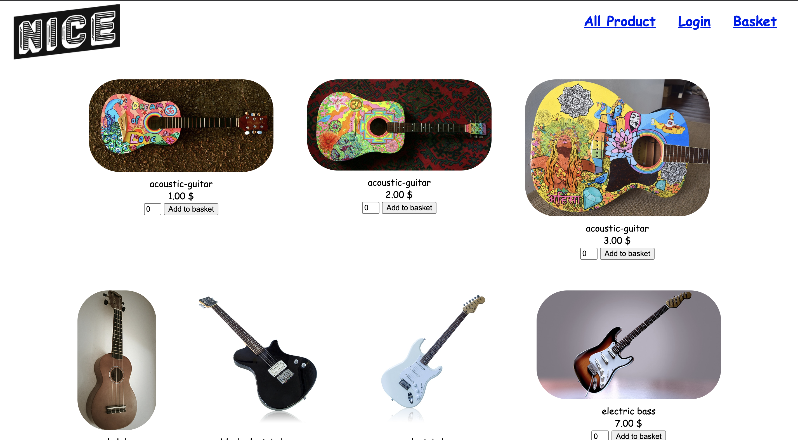

# Nice-Shop

A small e-commerce application for musical instruments, built as a 42Rush project — plain PHP and MySQL, no framework, no Composer, no build step.

[](https://www.php.net/)
[](https://www.mysql.com/)
[](https://www.docker.com/)

**Live demo:** <https://piscinephp-rush00.duthan.com/>



---

## Overview

Nice-Shop is a storefront where customers browse instruments by category, add them to a basket and place an order. Accounts are handled with PHP sessions and bcrypt-hashed passwords, and an administrator role (a flag on the user record) unlocks a back office for managing categories, products, orders and users.

The application ships with a first-run installer. On the very first request, the app detects that no database exists yet, creates the schema, seeds six categories and twenty sample products, creates the first administrator account from your environment variables, and then redirects you to the storefront.

---

## Features

### Storefront
- Product grid showing every item, or filtered by category via the **All Product** dropdown
- Item detail page with picture, price and an add-to-basket form
- Session-based shopping basket with quantity and running totals
- Checkout that requires an account, writing the order and its line items to the database
- Order history per customer

### Account
- Sign up, log in and log out
- Edit your own first name, last name and password
- Delete your own account
- **Setting** hub page linking to the above, plus the admin section for administrators

### Administration
- Dashboard linking to the three management areas
- **Products** — full create / read / update / delete for categories and items, with position-based reordering inside each category
- **Orders** — every order placed by every customer, with line items and totals
- **Users** — create, edit and delete accounts, and grant or revoke administrator privileges

---

## Tech stack

| Layer | Choice |
|---|---|
| Language | PHP 8.2 |
| Web server | Apache (via the official `php:8.2-apache` image) |
| Database | MySQL 8 |
| DB access | Procedural `mysqli`, no ORM or query builder |
| Front end | Server-rendered PHP templates and hand-written CSS — no JavaScript framework |
| Structure | Classic `private/` (logic) + `public/` (entry points) + `shared/` partials |
| Packaging | Docker, Docker Compose |
| Registry | GitHub Container Registry (`ghcr.io`) |
| CI/CD | GitHub Actions builds and pushes the image on every push |

There is no `composer.json` and no dependency to install — the whole application is the code in this repository.

---

## Installation

There are two ways to run the app, depending on what you want:

| | `docker-compose.prod.yml` | `docker-compose.dev.yml` |
|---|---|---|
| Purpose | Run the **published image** | Run the **code in your clone** |
| Image source | `ghcr.io/xopxop/piscinephp-rush00:latest` | built locally from `Dockerfile` |
| Source code needed | no | yes |
| Host port | `${APP_SERVER_PORT}` | `8080` |

Both compose files define the same two services: the PHP/Apache app and a MySQL 8 database. The app waits for the database to pass its health check before starting.

> Just want to look around first? There is a running instance at <https://piscinephp-rush00.duthan.com/>.

### 1. Production — run the published image

This is the recommended way to install Nice-Shop. Nothing is built and no source code is cloned: Docker pulls the image that GitHub Actions published from the repository.

```bash
# 1. Get the compose file
curl -O https://raw.githubusercontent.com/xopxop/piscinePHP-rush00/main/docker-compose.prod.yml

# 2. Create the environment file
nano .env

# 3. Start the stack
docker compose -f docker-compose.prod.yml up -d
```

Then open **http://localhost:8080/** in your browser (adjust the port if you changed `APP_SERVER_PORT`).

On the first request the installer runs automatically: it creates the database and tables, seeds six categories (Guitar, Basses, Drums, Keys, Strings, Others) and twenty sample products, and creates the first administrator using the `ADMIN_*` values from your `.env`. You are then redirected to the storefront.

Log in at `/public/login.php` with the `ADMIN_USER` and `ADMIN_PASSWORD` you configured — that account has administrator privileges and can reach the admin area at `/public/admin/index.php?id=1`.

To stop the stack:

```bash
docker compose -f docker-compose.prod.yml down
```

### 2. Development — run the code in your clone

Use this when you want to work on the source. `docker-compose.dev.yml` builds the image from the local `Dockerfile` instead of pulling one, so changes to `private/`, `public/` and `install.php` are picked up on the next build.

```bash
# 1. Clone the repository
git clone git@github.com:xopxop/piscinePHP-rush00.git
cd piscinePHP-rush00

# 2. Create the environment file
cp .env.example .env
nano .env

# 3. Build and start
docker compose -f docker-compose.dev.yml up --build
```

Open **http://localhost:8080/** — the port is fixed to `8080` in `docker-compose.dev.yml`, so `APP_SERVER_PORT` is ignored in this mode.

After editing code, rebuild with:

```bash
docker compose -f docker-compose.dev.yml up --build
```

To start over from an empty database, remove the volume directory and reload the page:

```bash
rm -rf mysql-data
```

---

## Environment variables

Configuration is passed to the container as environment variables and read by `private/db_credentials.php` through `getenv()`. There is no `.env` parser inside PHP — the `.env` file is consumed by Docker Compose only.

| Variable | Used by | Description |
|---|---|---|
| `APP_SERVER_PORT` | prod | Host port mapped to the container's port 80. Example: `8080`. Ignored by `docker-compose.dev.yml`, which hard-codes `8080`. |
| `DB_HOST` | both | MySQL host. Must stay `db` — that is the service name inside the compose network. |
| `MYSQL_ROOT_PASSWORD` | both | Password for the MySQL `root` user. Also supplied to the app as `DB_PASS`. |
| `MYSQL_DATABASE` | both | Name of the database to create and use. Also supplied to the app as `DB_NAME`. |
| `ADMIN_USER` | installer | Username of the first administrator account. Read once, when the database is created. |
| `ADMIN_PASSWORD` | installer | Password of that account; stored bcrypt-hashed. Read once, at install time. |
| `ADMIN_FIRSTNAME` | installer | First name of that account. Read once, at install time. |
| `ADMIN_LASTNAME` | installer | Last name of that account. Read once, at install time. |

The app always connects as `root`; `DB_USER` is not configurable.

Sample `.env`:

```bash
APP_SERVER_PORT=8080
DB_HOST=db
MYSQL_ROOT_PASSWORD=your-db-password
MYSQL_DATABASE=nice_shop
ADMIN_USER=admin
ADMIN_PASSWORD=your-admin-password
ADMIN_FIRSTNAME=Your
ADMIN_LASTNAME=Name
```

The four `ADMIN_*` values are only consumed by the installer. To change the administrator's details later, use the admin user-management screens rather than editing `.env`.

---

## Routes

There is no router — every page is a real file under `public/`, and pages take query-string parameters.

### Public

| URL | Purpose |
|---|---|
| `/` | Entry point: redirects to the storefront, or to the installer if the database is missing |
| `/public/index.php` | Storefront, all products |
| `/public/index.php?subject_id=<id>` | Storefront filtered by category |
| `/public/index.php?id=<id>` | Single item detail |
| `/public/login.php` | Log in |
| `/public/logout.php` | Log out |
| `/public/user/new.php` | Sign up |
| `/public/user/index.php?id=<id>` | Account settings hub |
| `/public/user/edit.php?id=<id>` | Edit account |
| `/public/user/delete.php?id=<id>` | Delete account |
| `/public/basket/index.php` | Basket, with `?delete=<item_id>` to remove a line |
| `/public/basket/order.php` | Confirm the order, or view past orders |
| `/install.php` | First-run installer |

### Administration

| URL | Purpose |
|---|---|
| `/public/admin/index.php?id=<id>` | Admin dashboard |
| `/public/admin/subjects/index.php?id=<id>` | List categories |
| `/public/admin/subjects/new.php` | Create category |
| `/public/admin/subjects/show.php?id=<id>` | Category detail and its products |
| `/public/admin/subjects/edit.php?id=<id>` | Edit category |
| `/public/admin/subjects/delete.php?id=<id>` | Delete category and its products |
| `/public/admin/items/new.php?subject_id=<id>` | Create product |
| `/public/admin/items/show.php?id=<id>` | Product detail |
| `/public/admin/items/edit.php?id=<id>` | Edit product |
| `/public/admin/items/delete.php?id=<id>` | Delete product |
| `/public/admin/orders/index.php?id=<id>` | All orders |
| `/public/admin/users/index.php?id=<id>` | List users |
| `/public/admin/users/new.php?id=<id>` | Create user |
| `/public/admin/users/edit.php?id=<id>` | Edit user, grant admin |
| `/public/admin/users/delete.php?id=<id>` | Delete user |

`?id=` is the id of the logged-in user for account and dashboard pages, and the id of the record for admin pages.

---

## Project structure

```
.
├── index.php                  # entry point, redirects to app or installer
├── install.php                # first-run installer: schema + seed data + first admin
├── Dockerfile                 # php:8.2-apache + mysqli
├── docker-compose.prod.yml    # runs the image published to GitHub Packages
├── docker-compose.dev.yml     # builds and runs the code in this repo
├── assets/
│   └── Screenshot.png         # demo screenshot used in this README
├── private/
│   ├── initialize.php         # bootstrap: session, paths, includes, DB connection
│   ├── db_credentials.php     # reads configuration from environment variables
│   ├── database.php           # connection helpers
│   ├── query_functions.php    # all SQL: subjects, items, users, orders
│   ├── auth_functions.php     # login, logout, access guards
│   ├── validation_functions.php
│   ├── functions.php          # url_for(), h(), redirect_to(), error display
│   └── shared/                # header and footer partials
└── public/
    ├── index.php              # storefront
    ├── show_item.php          # single product card
    ├── login.php
    ├── logout.php
    ├── user/                  # sign up and account self-service
    ├── basket/                # basket and checkout / order history
    ├── admin/                 # admin dashboard, items, subjects, orders, users
    ├── images/
    └── stylesheets/
```

---

## Database schema

Created by `install.php` on first run. Five tables, no foreign keys:

| Table | Columns |
|---|---|
| `subjects` | `id`, `category_name`, `position` |
| `items` | `id`, `subject_id`, `item_name`, `position`, `price`, `image` |
| `users` | `id`, `access`, `first_name`, `last_name`, `username`, `hashed_password` |
| `orders` | `id`, `user_id`, `date`, `total_quantity`, `total_price` |
| `orderred_items` | `id`, `item_id`, `order_id`, `quantity`, `price` |

`users.access` is the administrator flag, and `position` controls the display order of categories and of the products inside a category.